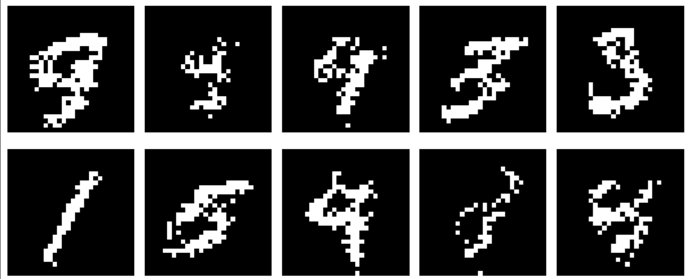

# Autoregressive MNIST From Scratch

A pixel-by-pixel autoregressive generative model for binarised MNIST, written in
plain PyTorch. No convolutions, no masking tricks, no library models — just an MLP
that predicts one pixel at a time.



---

## About The Project

The goal was to understand what "learning a distribution over images" actually
means, by building the simplest thing that works.

A 28×28 binarised digit is 784 numbers. Modelling all of them jointly is hopeless —
a single Gaussian over 784 dimensions just gives you the average digit with noise on
top. So instead the joint distribution is factorised into 784 small ones:

```
p(image) = p(pixel_1) · p(pixel_2 | pixel_1) · p(pixel_3 | pixel_1, pixel_2) · ...
```

Each factor is a one-dimensional distribution — "what value does this pixel take,
given everything drawn so far." That's a question an MLP can answer. Multiply them
all together and you have the exact likelihood of the image, no approximation and no
latent variables.

Generation runs the same factorisation forward: sample pixel 1, feed it back, sample
pixel 2, and so on for 784 steps.

---

## How The Loss Works

This is the part worth explaining properly, because it's the thing that confused me
longest.

**The network never outputs a pixel value.** It outputs a *distribution* over what
the pixel could be. Here that's a Gaussian, so the network emits two numbers: a mean
`μ` and a log standard deviation `log σ`.

Training then does this, for every pixel of every image:

1. Feed the context (pixels drawn so far, plus the position being predicted)
2. The network produces a distribution — a Gaussian with that `μ` and `σ`
3. Look at what the pixel **actually** was in the real image
4. Read off how high the curve is at that value
5. Loss = `−log` of that height

So if the model predicted `μ = 0.95` with a small `σ` and the pixel really was 1,
the curve is tall there and the loss is small. If it predicted `μ = 0.95` and the
pixel was 0, the curve is almost flat at 0 and the loss is large.

In code:

```python
mu, log_sigma = net(x).chunk(2, dim=-1)
sigma = log_sigma.clamp(LOW, 2).exp()

dist = torch.distributions.Normal(mu.squeeze(-1), sigma.squeeze(-1))
loss = -dist.log_prob(target).mean()
```

That's it. `log_prob` evaluates the Gaussian density at the observed value; the
negative of it is the loss. This is exactly maximum likelihood — the loss function
wasn't a design decision, it fell out of the probability model.

**One thing I had backwards at first:** there is no "target distribution" being
compared against the predicted one. There's a predicted distribution and a single
observed number. You evaluate the distribution at that number. Nothing is being
compared to anything.

That said, the distributions *do* converge — just at a different level. Minimising
negative log-likelihood is equivalent to minimising `KL(true ‖ model)`, so across
the dataset the model's conditional distributions approach the real ones. You just
never compute that KL directly, because you'd need the true distribution to do it.

**Also note the loss can go negative, and that's fine.** `log_prob` returns a log
*density*, not a log probability. A narrow Gaussian can be taller than 1, making the
log positive and the loss negative. Which leads directly to the main finding below.

---

## The σ Collapse

This was the one real bug, and it's worth documenting because the loss curve lies
about it.

The first version clamped `log σ` to `[-7, 2]`, allowing σ down to about 0.0009.
Training looked like it was working — the loss fell steadily, well into negative
territory — but the samples were salt-and-pepper noise.

**The loss was improving for the wrong reason.** At σ = 0.0009 a Gaussian's peak
density is around 437, so the log-density is about 6.1. The optimiser discovered it
could push the loss toward −6 purely by shrinking σ, with no requirement that μ get
any better. It was buying loss with scale instead of accuracy.

Three symptoms, in hindsight all diagnostic:

- **Loss going negative and continuing to fall.** Not a bug by itself — densities do
  that — but it kept falling while sample quality stayed flat.
- **Occasional enormous spikes.** One epoch jumped from −1.6 to +3.0. With σ near
  zero the `(x−μ)²/2σ²` term explodes on any wrong prediction, producing a gradient
  large enough to knock the model sideways.
- **Loss improving while samples didn't.**

**The fix was one number: raise the floor on σ.**

```python
sigma = log_sigma.clamp(LOW, 2).exp()    # LOW raised from -7
```

That closes the escape route. The model can still express confidence, but it can no
longer reduce the loss by shrinking scale, so the gradient has nowhere to go except
into the mean.

That single change turned noise into digits. No change of distribution family, no
architectural change, no extra training.

**Worth stating plainly, since the obvious diagnosis is wrong:** the problem was not
that a Gaussian is a poor fit for binary data. A Gaussian head works fine here. The
problem was leaving its scale parameter unbounded below, on data where the
conditional distributions are nearly deterministic and σ therefore has an incentive
to run to zero.

---

## Dataset

Binarised MNIST at full 28×28 resolution, thresholded at 127. 1,000 training images.

Because this implementation does **not** use masked convolutions, every
(context, next pixel) pair is materialised explicitly:

- 1,000 images × 784 pixel positions = **784,000 training examples**
- each example is a 784-length context with everything from position `d` onward
  zeroed, plus 2 numbers for position

This is deliberately the naive approach. A masked-convolution model computes all 784
conditionals in a single forward pass; this one needs 784 separate passes. The
slowdown is the point — it makes concrete what the masking trick actually buys.

---

## Position Encoding

The context alone is ambiguous. MNIST's top rows are blank in nearly every image, so
the context for position 20 and position 60 can both be all zeros — identical inputs
with different answers. The network cannot tell which pixel it's being asked about.

The fix is to append the position explicitly. Row and column are passed separately,
normalised:

```python
position = np.array([d // 28, d % 28], dtype=np.float32) / 28.0
```

Separately, not as a flat index — otherwise the network has to recover 2D structure
from one scalar, which means learning integer division and modulo. Pixels 20 and 48
are vertically adjacent but 28 apart numerically; as `(row, col)` that relationship
is immediate.

---

## Sampling

At generation time the Gaussian is sampled and then thresholded back to binary:

```python
pixel = mu + sigma * torch.randn_like(mu)
context[0, d] = float(pixel.item() > 0.5)
```

The threshold matters. Every context seen during training contained only 0s and 1s,
so feeding back a raw float like 0.43 would put the model off-distribution
immediately.

---

## Known Limitations

- **No convolutions.** A plain MLP over a flattened vector, so there's no spatial
  inductive bias whatsoever. It has to learn locality from scratch.
- **No masked convolutions**, so training is roughly 784× more expensive per epoch
  than it needs to be.
- **784 sequential forward passes per sample.** Generation is slow, and this scales
  with resolution — the fundamental cost of autoregressive sampling.
- **A Gaussian is unimodal.** Where the context leaves genuine ambiguity — is this
  pixel the last of a stroke or the first of the background — the model can only
  answer with a mean, and the 0.5 threshold decides. A Bernoulli head could place
  mass on both outcomes and sample one. In practice this matters less than expected.
- **Raster ordering is arbitrary.** The top-left pixel conditions on nothing, the
  bottom-right on everything. That asymmetry has nothing to do with how images work,
  and it means long-range consistency has to travel a long way through the sequence.
- **Only 1,000 training images**, so the model has seen a small slice of MNIST.
- **No temperature or top-k sampling**, so nothing prevents an unlikely draw from
  derailing a digit partway through.
- **Exposure bias.** Training always sees real contexts; sampling sees the model's
  own output. Mistakes compound with no mechanism to recover.

---

## Built With

- Python
- PyTorch
- NumPy
- Matplotlib

---

## Key Learning Goals

Built to understand generative modelling from the ground up:

- what it actually means for a neural network to "output a distribution"
- why the network emits *parameters* of a family rather than a probability directly
- why cross-entropy and MSE are both just negative log-likelihood under different
  families
- that a loss can improve for reasons unrelated to the thing you care about, and how
  to spot it
- why conditioning removes blur — you only average when you don't know
- where sampling breaks gradients, and why autoregressive training sidesteps it
- what teacher forcing buys, and that exposure bias is the price
